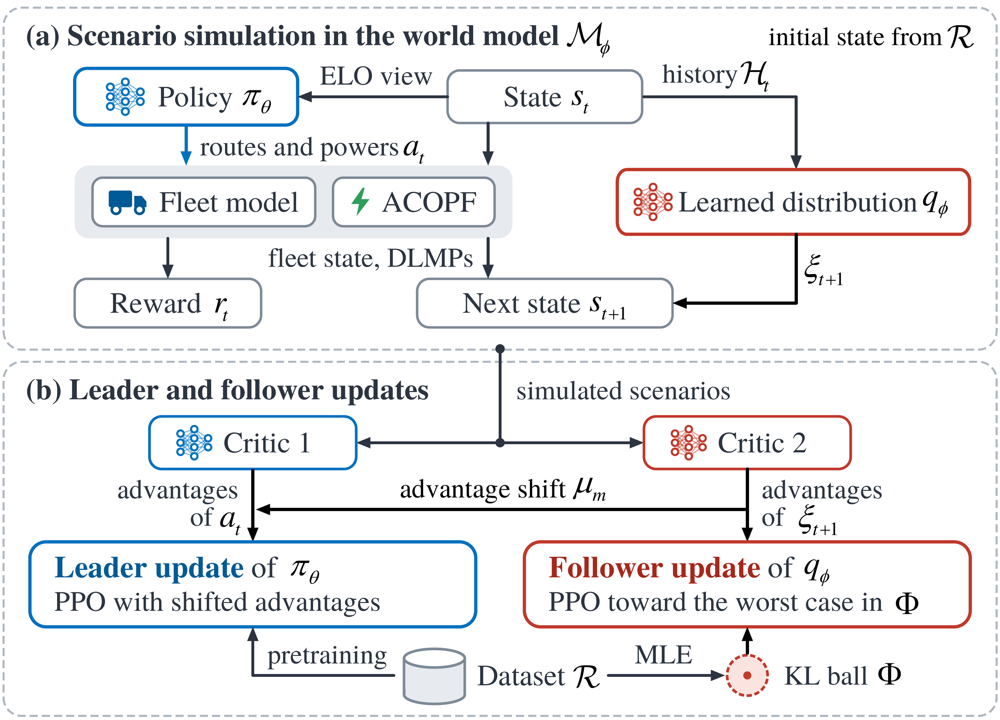
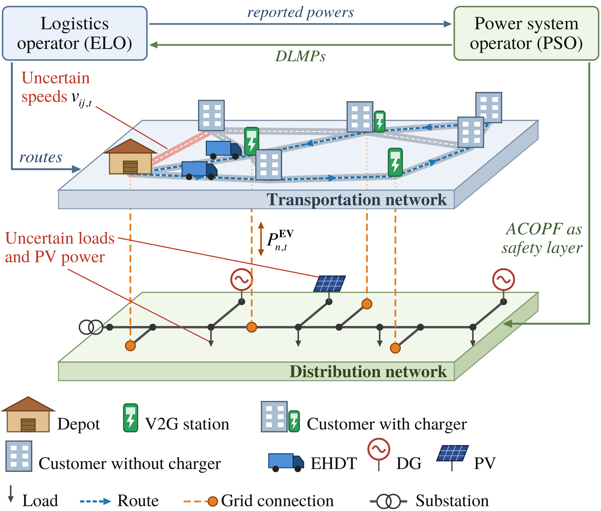

# Coordinated Routing and Vehicle-to-Grid Scheduling of Electric Heavy-Duty Trucks: A Bilevel Game-Guided World Model Approach

Jingxiang Wang1, Shijie Li1, Qianwen Xu1,\* (\*Corresponding author)

1[Department of Electric Power and Energy Systems](https://www.kth.se/epe/), [KTH Royal Institute of Technology](https://www.kth.se/en), Stockholm, 11428, Sweden

---

## Abstract

Electric heavy-duty trucks (EHDTs) can provide vehicle-to-grid (V2G) services to distribution networks while delivering goods. However, stochastic traffic speeds, loads, and photovoltaic power make the travel times and distribution locational marginal prices (DLMPs) highly uncertain. In rare extreme scenarios such as severe congestion, large prediction errors cause late deliveries and high costs. Existing reinforcement learning (RL) methods train a world model for prediction accuracy, separately from the policy. This ignores how the prediction errors in such scenarios affect the decisions. To this end, we propose a bilevel game-guided world model approach for the coordinated routing and V2G scheduling of EHDTs, where the policy network is the leader and the world model is the follower. The world model combines the known fleet and distribution network models with learned distributions of the uncertain variables. We construct a Kullback–Leibler ball around the trained world model to cover the true one, and maximize the worst-case performance of the policy over this ball. This can improve the robustness of the policy to rare extreme scenarios. We propose a gradient computation method considering the response of the follower, and prove that this response only shifts the advantages. With a lightweight approximation based on the Fisher information matrix, the policy network can be trained by standard RL algorithms with little extra computation. Case studies on a real transportation network in Stockholm, Sweden, coupled with the IEEE 33-bus system validate the effectiveness of the proposed approach.

## Introduction of Our Approach

- The EHDT logistics operator (ELO) decides the routes and the charging and discharging powers of the EHDTs in each time step and reports the powers. The power system operator (PSO) then solves the AC optimal power flow (ACOPF) of the distribution network (DN) and settles the reported powers at the DLMPs. The DLMPs reflect the spatiotemporal value of power in the DN, which coordinates the V2G scheduling with the economic and secure operation of the DN.
- The policy is trained in a world model that keeps the known models of the fleet and the DN and only learns the distribution of the uncertain variables, i.e., the link speeds, the loads, and the available PV power. Every simulated transition therefore satisfies the constraints of the fleet and the DN.
- The policy network is the leader and the world model is the follower. The follower adapts the world model within a Kullback–Leibler (KL) ball around the trained model to emphasize the scenarios unfavorable to the leader, so the policy is trained for the worst case in the ball.
- The response of the follower is taken into account by the total derivative of the leader objective, derived from the Karush–Kuhn–Tucker conditions of the lower-level problem. This response only shifts the advantages. The second-order derivatives of the world model are approximated by the Fisher information matrix and inverted by the Woodbury identity, so the policy is still trained by proximal policy optimization (PPO) with little extra computation.

## Test System

The test system couples an EHDT fleet in the southern part of Stockholm (Söderort), Sweden, with the IEEE 33-bus DN (Section II of the paper). All parameters below are those used for the results in the paper.

### Transportation Network

- **Road nodes and links.** The 16 road nodes are real places, and the 23 bidirectional links follow real roads. The length of a link is the great-circle distance between its end nodes multiplied by a circuity factor of 1.15, 1.25, and 1.35 for motorways, arterial roads, and urban streets. The free-flow speeds of these road classes are 70, 50, and 35 km/h.
- **Locations.** There are 2 depots, 3 V2G stations, and 200 customer sites. Eleven customer sites are named places. The other 189 are generated 0.3–1.5 km from the road nodes other than the depots, and each is connected to its node by an urban street whose speed ratio is the mean of the links at that node.
- **Arcs.** Each arc follows the shortest path at free-flow speeds. Its travel time is computed by (1a) of the paper from the speeds of the links on the path, and its energy consumption by (1b). The mean arc distance is 9.3 km, and the mean distance from the home depot to a customer site is 6.8 km.

| Location | Type | Charger | DN bus |
| :--- | :--- | :--- | :---: |
| Årsta partihallar | Home depot $`0`$ | 125 kW, bidirectional | 2 |
| Västberga | Depot | 125 kW, bidirectional | 5 |
| Liljeholmen, Globen, Farsta | V2G stations | 125 kW, bidirectional | 22, 23, 24 |
| 15 customer sites | Customers | 50 kW, charging only | 1, 3, 4, 8, 9, 11, 12, 14, 15, 17, 18, 21, 29, 30, 31 (randomly assigned) |
| 185 customer sites | Customers | None | None |

The 125 kW chargers follow the data sheet of a bidirectional DC charger [[1]](#ref1), and the 50 kW chargers follow that of a unidirectional DC charger [[2]](#ref2).

### Fleet and Customers

| Item | Setting |
| :--- | :--- |
| EHDTs $`K`$ | 12, all starting from and returning to the home depot |
| Battery capacity $`\overline E`$ | 336 kWh (installed capacity of the Mercedes-Benz eActros 300 [[3]](#ref3)) |
| Minimum energy $`\underline E`$ | 10% of $`\overline E`$ |
| Efficiency $`\eta`$ | 0.95 |
| Load capacity $`\overline W`$ | 20 t, refilled at the depots |
| Energy model (1b) | $`h_1=1.088\times10^{-4}`$ kWh/km per (km/h)2 and $`h_2=0.654`$ kWh/km, from a gross mass of 26 t, a drag area of 5.5 m2, a rolling resistance coefficient of 0.006, an air density of 1.2 kg/m3, and a drivetrain efficiency of 0.65 (0.93 kWh/km at 50 km/h) |
| Orders | Each customer site places an order with probability 0.8 per day, i.e., about 160 orders per day |
| Demand $`w_i`$ | Uniform in [1, 4] t, rounded to 0.5 t |
| Service time $`\tau^{\mathrm{sv}}_i`$ | Uniform in [15, 30] min |
| Time window $`[\underline t_i,\overline t_i]`$ | Opening time uniform in [6:00, 14:00] and width uniform in [1, 2] h, both rounded to 0.5 h |
| Horizon | From 6:00 to 6:00 of the next day, $`T=96`$ time steps of $`\Delta t=15`$ min |

### Distribution Network

| Item | Setting |
| :--- | :--- |
| Topology | IEEE 33-bus system [[4]](#ref4), 12.66 kV, base power 1 MVA. The buses are numbered 0–32, and bus 0 connects the DN to the main grid |
| Loads | 0.3 times the loads in [[4]](#ref4), with a total peak of 1.11 MW. Buses 6, 7, 13, 23, 24, 29, 30, and 31 are commercial, and the others are residential |
| DGs | Buses 13 and 29, each 0–400 kW and −300 to 300 kvar, ramping limit 200 kW per time step, $`\lambda^{\mathrm{G1}}_n=0.0755`$ EUR/kWh and $`\lambda^{\mathrm{G2}}_n=0`$ (fuel and CO2 cost of an open-cycle gas turbine) |
| PV units | Buses 8, 16, 20, and 31 with 200, 250, 200, and 250 kW in 2022 |
| Voltage limits | 0.95–1.05 p.u., with $`U_0=1`$ p.u. |
| Current limits | 1.5 times the current with the loads in [[4]](#ref4) supplied by the main grid, and at least 1.2 p.u. The line from bus 2 to bus 22 is limited to 0.3 p.u., so the branch 22–23–24 with the V2G stations is congested on many weekdays in the daytime |
| Main grid | Purchase and sale at $`\lambda^{\mathrm S}_t`$ with $`\overline P^{\mathrm S}=3000`$ kW. $`\lambda^{\mathrm S}_t`$ is the 2022 day-ahead price of the SE3 bidding zone on a typical weekday of each season [[5]](#ref5) |
| Load shedding | $`\lambda^{\mathrm{shed}}=7.76`$ EUR/kWh, the value of lost load in Sweden [[6]](#ref6) |
| ACOPF | Second-order cone relaxation (14) solved by Clarabel through CVXPY. In the online implementation, the solution is checked by an AC power flow and re-solved with a penalty on the line losses if the relaxation gap exceeds 10−4 p.u. |

### Costs and Delivery Fees

The costs are in EUR, with 10.63 SEK/EUR (average of 2022).

| Coefficient | Value | Source |
| :--- | :---: | :--- |
| Distance $`\lambda^{\mathrm d}`$ | 0.105 EUR/km | Maintenance cost of a battery-electric regional delivery truck [[7]](#ref7) |
| Overtime $`\lambda^{\mathrm o}`$ | 55 EUR/h | Value of freight transport time, 44 EUR per vehicle-hour in 2010 [[8]](#ref8), converted to 2022 prices by the euro area HICP |
| Degradation $`\lambda^{\mathrm{deg}}`$ | 0.001 EUR/kWh | The battery is covered by the warranty or by battery leasing (assumption) |
| Unserved customer $`\lambda^{\mathrm{uns}}`$ | 220 EUR | The order is outsourced to a hired truck with a driver for 4 h at 55 EUR/h |
| Energy target $`\lambda^{\mathrm{tar}}`$ | 0.35 EUR/kWh | Public fast charging for heavy-duty vehicles in Sweden after the horizon, 3.699 SEK/kWh excluding VAT [[9]](#ref9) |
| Late return $`\lambda^{\mathrm{ret}}`$ | 440 EUR | A replacement truck with a driver for 8 h at 55 EUR/h |
| Delivery fee $`\lambda^{\mathrm f}`$ | 5.5 EUR/km of $`d_{0j}`$ | Calibrated so that the rule-based optimization without V2G earns a margin of 5% after the costs of the drivers (35 EUR/h, 8 h per EHDT per day) and the trucks (186,000 EUR, 5 years, 9.5% interest, residual value 45,000 EUR, insurance 2.73% per year [[7]](#ref7)) |

Each customer with an order pays the fee whether the order is served by the fleet or outsourced. The fees enter the logistics cost (13a) with a negative sign, and the profit reported in the paper is the negative of the objective in (12), without the fixed costs of the drivers and the trucks.

## Uncertain Variables

The link speeds, the loads, and the available PV power are synthetic time series at a 15 min resolution for 2022 and 2023. Swedish public holidays are treated as weekends.

- **Link speeds.** Daily profiles of each road class with morning and evening peaks, day-to-day variations, weather effects, spatially correlated fluctuations, and random incidents that also slow down the adjacent links.
- **Loads.** Residential and commercial daily profiles on weekdays and weekends, a heating load driven by the temperature, and random fluctuations at each bus.
- **PV power.** Clear-sky irradiance in Stockholm [[10]](#ref10) multiplied by a random clear-sky index that varies with the season and within the day.

The test year differs from the training year. The loads, the PV capacity, and the incident rate grow gradually, and the peak-hour speeds decrease. Moreover, a roadwork on Södra länken between Årsta partihallar and Globen reduces the speeds from March to June 2023. Therefore, the test days are not drawn from the training distribution.

### Stress Tests

To evaluate the robustness, extra incidents are added to the test days. The training and validation days are not changed. Each extra incident occurs on a random link, starts between 7:00 and 18:00, and changes the log speed ratio of the adjacent links by half as much.

| Level | Extra incidents per day (Poisson mean) | Speed during an incident | Duration |
| :--- | :---: | :---: | :---: |
| No stress | 0 | – | – |
| 4, 8, and 12 incidents | 4, 8, and 12 | 20–40% | 1.5–3 h |
| 4 and 8 severe incidents | 4 and 8 | 5–20% | 3–5 h |

## Simulation Setting

### Data Partitions

The months January, March, May, July, September, and November are used in both years.

| Split | Days | Use |
| :--- | :---: | :--- |
| Training | 140 days of 2022 (3 of every 4 weeks) | Historical dataset $`\mathcal R`$, training of the world model, and initial states of the simulated scenarios |
| Validation | 44 days of 2022 (the remaining weeks) | Evaluation of the policy every 10 iterations. For each run, the policy with the highest validation profit is used for testing |
| Testing | 184 days of 2023 | Evaluation in the real system |

The historical dataset $`\mathcal R`$ records the decisions of the rule-based optimization in the real system on the training days, where the PSO solves the ACOPF and settles the powers at the DLMPs. To diversify the data, 5% of the departures go to another random feasible location, and the powers have a relative noise of 10%. On half of the days, the rules also discharge at the bidirectional chargers when the local price is at least 0.15 EUR/kWh, so that the pretrained policy also sees discharging.

### Benchmarks

| Method | Setting |
| :--- | :--- |
| Rule-based optimization | The EHDTs are dispatched by the earliest deadline, charge at full power whenever they stop at a charger until full, and never discharge. The rules do not observe the DN |
| MPC | Re-plans every hour with the point forecasts of the trained world model. The routes are built from those of the rule-based optimization by regret-2 insertion and local search within 5 s. The powers of each EHDT are solved by a linear program with the forecast DLMPs, and the DLMPs are updated by the ACOPF with the planned powers for up to 10 rounds by the method of successive averages |
| RL on history | PPO with the same policy network, where the scenarios replay the historical uncertain variables of the training days without a world model |
| RL with a point-forecast world model | PPO with the same policy network, where the uncertain variables in the scenarios are the expected values given by the trained world model |
| Proposed | Bilevel game-guided training (Algorithm 1 of the paper) |

All RL methods start from the same pretrained policy and use the same PPO hyperparameters.

### Training Protocol

| Item | Setting |
| :--- | :--- |
| World model | Trained by maximum likelihood (18) for 60 epochs with Adam, learning rate 2×10−3 with cosine decay to 10−4, batch size 256 |
| KL radius $`\epsilon`$ | 1.49 |
| Pretraining of the policy | Behavior cloning of $`\mathcal R`$ for 10 epochs, learning rate 10−3, batch size 64 |
| Iterations | 1000, where only the critics are trained in the first 10 iterations |
| Scenarios | $`N^{\mathrm r}=250`$ per iteration. Each scenario starts from a state sampled from $`\mathcal R`$ and is simulated to the end of the day, with the ACOPF solved in each time step |
| Validation | Every 10 iterations on the 44 validation days in the real system. The policy with the highest validation profit is used for testing |
| Random seeds | 0–8 (9 seeds) for the convergence of the proposed approach, and 0–2 for the test results of all RL methods, which are averaged over the seeds |

### Hyperparameters

| Hyperparameter | Value | Hyperparameter | Value | Hyperparameter | Value |
| :--- | :---: | :--- | :---: | :--- | :---: |
| History length $`N^{\mathrm w}`$ | 8 | Bins $`N^{\mathrm b}`$ | 33 | Scenarios $`N^{\mathrm r}`$ | 250 |
| Histories for $`\hat D_{\mathrm{KL}}`$ $`N^{\mathrm a}`$ | 256 | Discount factor $`\gamma`$ | 1.0 | GAE coefficient $`\zeta`$ | 0.95 |
| Step size $`\alpha_\theta`$ | 3×10−5 | Step size $`\alpha_\phi`$ | 3×10−4 | Learning rate of the critics | 5×10−4 |
| Clipping range $`\kappa`$ | 0.2 | Epochs of $`\theta`$, $`\phi`$, and $`\psi`$ | 4, 2, 8 | Minibatch size | 256 |
| Damping $`\delta`$ | ≥ 1.0 | Smoothing of $`\nu`$ | 0.5 | Gradient norm clipping | 1.0 |
| Policy network and critics | Transformer, width 64, 2 layers | World model | Recurrent networks, hidden size 32 | Maximum concentration of the Beta distribution | 20 |

### Evaluation

The policies are evaluated in the real system on all test days, where the PSO solves the ACOPF in each time step and settles the reported powers at the DLMPs. The metrics are the profit of the ELO, the cost terms in (13), the late hours, the unserved customers, the cost of the PSO, the load shedding, the voltages, and the computation time per time step.

### Implementation and Hardware

| Item | Setting |
| :--- | :--- |
| Software | PyTorch 2.11 (CUDA 12.8), NumPy 2.4, and CVXPY 1.9 with the Clarabel solver |
| Hardware | A workstation with two NVIDIA GeForce RTX 5090 GPUs (seeds 0–4 of the proposed approach and all baselines) and a workstation with an NVIDIA GeForce RTX 4080 GPU (seeds 5–8 of the proposed approach) |
| Training time | 13–25 h per run of 1000 iterations, depending on the workstation and the number of parallel runs |

## Code

The complete code is coming soon.

## References

[1] Rhombus Energy Solutions, "RES-DCVC125-480-V2G bidirectional DC fast charger," data sheet.

[2] alpitronic, "hypercharger HYC50," data sheet.

[3] Mercedes-Benz Trucks, "eActros 300/400," technical data.

[4] M. E. Baran and F. F. Wu, "Network reconfiguration in distribution systems for loss reduction and load balancing," *IEEE Trans. Power Del.*, vol. 4, no. 2, pp. 1401–1407, 1989.

[5] Energinet, "Elspot prices," Energi Data Service, day-ahead prices of the SE3 bidding zone in 2022 (original data from Nord Pool).

[6] Energimarknadsinspektionen, "Beräkning av värdet av förlorad last (VoLL)," Ei PM2021:01, 2021 (82.52 SEK/kWh in 2020 prices).

[7] H. Basma and F. Rodríguez, "A total cost of ownership comparison of truck decarbonization pathways in Europe," Working Paper, International Council on Clean Transportation, Nov. 2023.

[8] G. de Jong, M. Kouwenhoven, J. Bates, P. Koster, E. Verhoef, L. Tavasszy, and P. Warffemius, "New SP-values of time and reliability for freight transport in the Netherlands," *Transp. Res. E, Logist. Transp. Rev.*, vol. 64, pp. 71–87, 2014.

[9] Milence, public charging prices for heavy-duty vehicles in Sweden, 2026.

[10] B. Haurwitz, "Insolation in relation to cloudiness and cloud density," *J. Meteorol.*, vol. 2, pp. 154–166, 1945.
